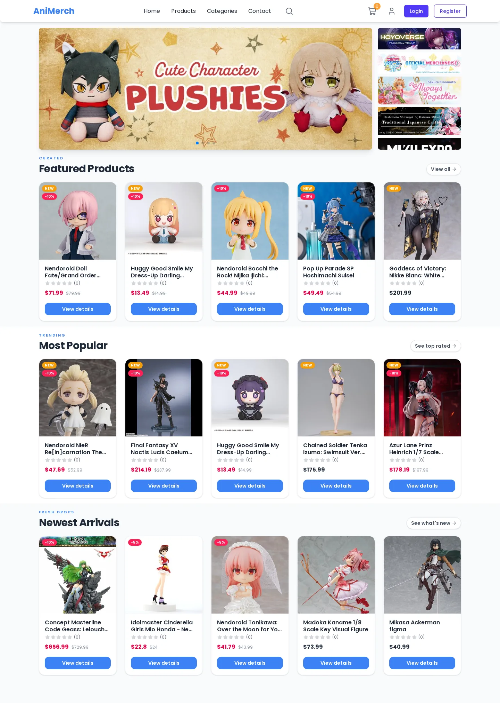
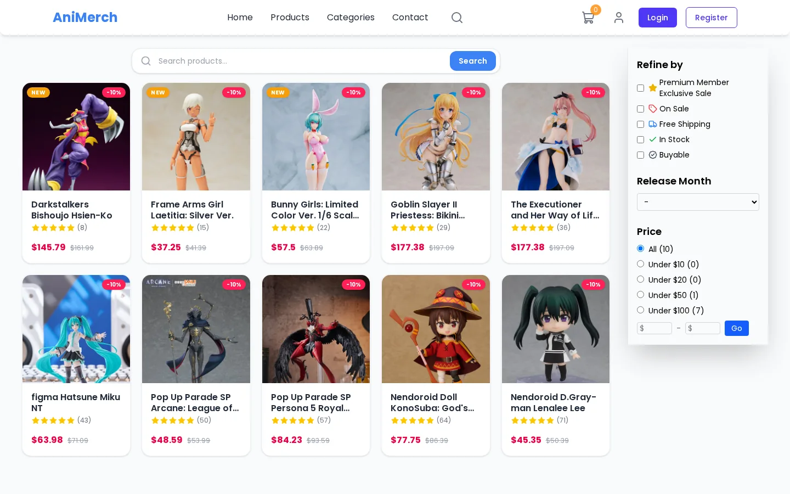
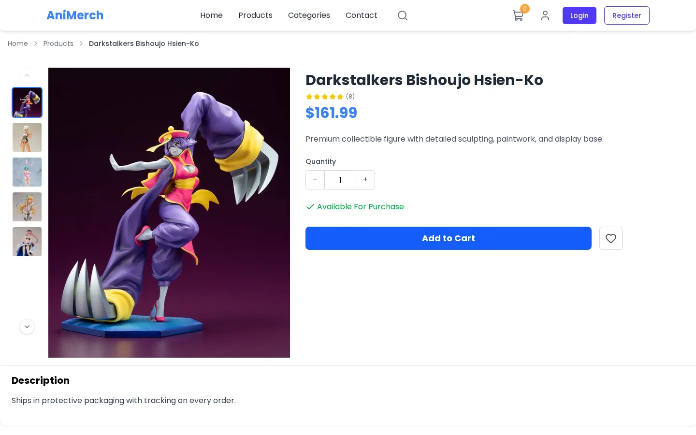
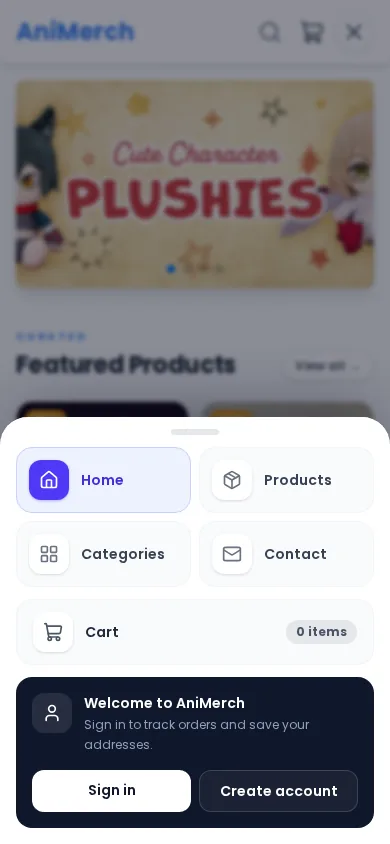
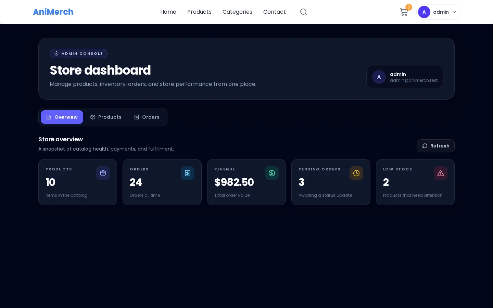

# AniMerch

A full-stack ecommerce demo: React 19 frontend, Bun + Hono + Mongoose API, Redis caching,
PayPal checkout with idempotent orders, and an admin dashboard.

## Screenshots

| Storefront                                                                      | Catalog                                                                            |
| ------------------------------------------------------------------------------- | ---------------------------------------------------------------------------------- |
| [](docs/screenshots/home.webp) | [](docs/screenshots/catalog.webp) |

| Product detail                                                                         | Mobile navigation                                                                                |
| -------------------------------------------------------------------------------------- | ------------------------------------------------------------------------------------------------ |
| [](docs/screenshots/product.webp) | [](docs/screenshots/mobile-nav.webp) |

[](docs/screenshots/admin.webp)

## Quick start

```bash
vp install                 # frontend + tooling
cd server && bun install   # API
cp .env.example .env       # fill in Mongo + PayPal values

vp dev                     # http://localhost:3000
cd server && bun run dev   # API on PORT (default 8888)
```

MongoDB is required. Redis is optional.

## License

MIT — see [`LICENSE`](./LICENSE).
